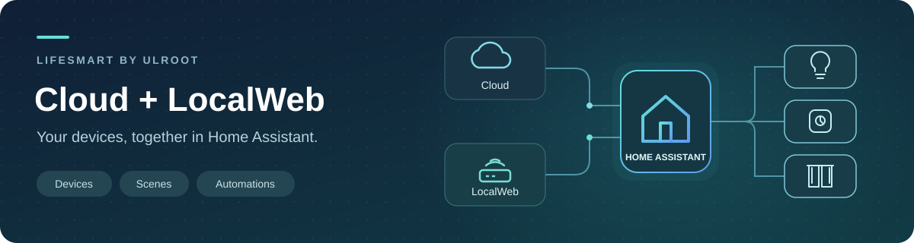

<p align="center">
  
</p>

<h1 align="center">LifeSmart for Home Assistant</h1>

<p align="center">
  <strong>Bring your LifeSmart devices into Home Assistant.</strong><br>
  Cloud · LocalWeb · by ULROOT
</p>

<p align="center"><strong>English</strong> · <a href="docs/README.ko.md">한국어</a></p>

<p align="center">
  <a href="custom_components/lifesmart_ulroot/manifest.json"></a>
  <a href="https://www.home-assistant.io/"></a>
  <a href="#connection-setup"></a>
  <a href="LICENSE"></a>
  <a href="docs/README.ko.md"></a>
  <a href="https://app.fossa.com/projects/git%2Bgithub.com%2FULROOT-DEV%2Flifesmart-plugin-for-homeassistant-by-ulroot?ref=badge_shield&amp;issueType=license"></a>
</p>

<p align="center">
  
</p>

<p align="center"><a href="#installation">Install</a> · <a href="#connection-setup">Connect</a> · <a href="#supported-devices">Devices</a> · <a href="#scenes-and-remotes">Scenes & remotes</a> · <a href="#troubleshooting-and-support">Support</a></p>

---

## What you can do

Control lights, switches, curtains and thermostats, check your sensors, and run LifeSmart scenes from Home Assistant dashboards and automations.

| ☁️ Cloud | 🏠 LocalWeb | 🧩 Multiple stations |
|---|---|---|
| Connect through your LifeSmart account. Sign in or enter an existing UserToken. | Connect directly to an activated Smart Station on your network. | Cloud imports all accessible stations at once. LocalWeb connects each station separately. |
| **🎬 Scenes & remotes**<br>Run saved scenes and send keys from supported SPOT remotes. | **📊 Devices & dashboards**<br>Keep each product's measurements together and build your own cards. | **🌐 English & Korean**<br>Setup screens and entity labels follow your HA language. |

## Before you start

You need **Home Assistant 2026.11.1 or newer** and a LifeSmart Smart Station with your devices already added.

| Connection | What to prepare |
|---|---|
| **Cloud** | Internet access, App Key and App Token. For account login, prepare your login ID and app password. For direct UserToken input, prepare your numeric **UserNo** and a valid UserToken. Obtain application credentials through the [LifeSmart Open Platform](https://www.ilifesmart.com/open/login). |
| **LocalWeb** | An activated station, its IP address or hostname, and its LocalWeb login ID/password. Home Assistant must be able to reach the station. |

> **LocalWeb needs activation.** Email your **LifeSmart account userno and app password (app pw)** to **[ss.kim@ulroot.com](mailto:ss.kim@ulroot.com)** to request activation. These account details are separate from the station's LocalWeb login. Send activation information only to the contact above, never in a public issue. The integration cannot activate a station for you.

## Installation

### Marketplace

[](https://my.home-assistant.io/redirect/marketplace_repository/?owner=ULROOT-DEV&repository=lifesmart-plugin-for-homeassistant-by-ulroot&category=integration)

1. Open **Settings → Marketplace → Add from link** in Home Assistant. Connect GitHub if prompted.
2. Enter this repository URL:

   ```text
   https://github.com/ULROOT-DEV/lifesmart-plugin-for-homeassistant-by-ulroot
   ```

3. Select **LifeSmart by ULROOT → Install**.
4. In the setup screen, choose **Cloud** or **LocalWeb** and enter your connection details.

You can reopen the installed item from Marketplace. If you closed setup, go to **Settings → Devices & services → Add integration → LifeSmart by ULROOT**. Follow any restart prompt. See the [Marketplace installation guide](https://www.home-assistant.io/integrations/marketplace/#installing-a-repository).

<details>
<summary><strong>Manual installation</strong> — copy the integration folder</summary>

1. Download the source or installation ZIP and extract it.
2. Copy the entire `custom_components/lifesmart_ulroot` folder into your Home Assistant configuration directory:

   ```text
   <HA config>/
   └── custom_components/
       └── lifesmart_ulroot/
           ├── __init__.py
           ├── manifest.json
           ├── LICENSE
           └── …
   ```

3. Restart Home Assistant.
4. Open **Settings → Devices & services → Add integration → LifeSmart by ULROOT**.

For Docker/NAS installations, use the folder mounted as the container's `/config`. Copy the integration folder, not the entire repository, into `custom_components`.

</details>

## Connection setup

### Cloud

Choose **Cloud**, select your account's API server, then enter your **App Key**, **App Token** and authentication details. **US** is the default server; use the server assigned to your account rather than choosing by your current location.

**Register the account once to import supported devices from all accessible stations.** Each device stays grouped under its own station. Newly added stations are discovered automatically, normally within five minutes. Access is limited to the stations authorized for your account and App Key.

For **direct UserToken input**, enter the numeric **LifeSmart UserNo**, for example **`8123456`**. Do not enter an email address. For account login, enter your LifeSmart login email, for example **`user@example.com`**, in the separate login ID field. A numeric UserNo is also accepted for login.

| Sign-in choice | How your token is handled |
|---|---|
| **Account login** | Enter your LifeSmart app password. Automatic UserToken renewal is always enabled for account login, including existing login entries after updating. The password is not saved. |
| **Direct UserToken · renewal off** | Use your existing token without changing it. This is the default for direct input and suits tokens managed by another application. |
| **Direct UserToken · renewal on** | Let this integration renew and save the token. Renewal can affect other applications using the same token. |

**If another app manages your UserToken, choose direct UserToken input and leave automatic renewal off.** When Home Assistant asks you to reauthenticate, enter the latest token. Your existing devices and entities are retained.

<details>
<summary>When does automatic renewal happen?</summary>

If the expiry time is unknown, the first connection renews the token immediately to obtain its expiry time. After that, API requests trigger renewal within **15 minutes before expiry**. An already expired or rejected token cannot be renewed. If Home Assistant was offline through expiry, sign in again or enter a valid token when prompted.

Open **Settings → System → Repairs** or the integration's reauthentication prompt. Direct-token reauthentication keeps the renewal preference; account login always enables renewal. To change direct-token renewal, authentication method, credentials or server, use **Reconfigure**.

</details>

<details>
<summary>Available API servers</summary>

| Choice | API host |
|---|---|
| **US** — default | `api.us.ilifesmart.com` |
| GLOBAL | `api.ilifesmart.com` |
| EUR | `api.eur.ilifesmart.com` |
| JP | `api.jp.ilifesmart.com` |
| APZ | `api.apz.ilifesmart.com` |
| CN0 | `api.cn0.ilifesmart.com` |
| CN1 | `api.cn1.ilifesmart.com` |
| CN2 | `api.cn2.ilifesmart.com` |

CN0 uses periodic polling for updates. If an older saved server no longer connects, use **Reconfigure** to select the server that matches your account.

</details>

### LocalWeb

1. Choose **LocalWeb** after your station has been activated.
2. Enter the **station's IP/hostname**, **LocalWeb login ID** and **LocalWeb password**.
3. Select **HTTP (8008)** or **HTTPS (8080)**. The port is set automatically.
4. For HTTPS, choose whether to verify the station's certificate, then finish setup.

Use the station's address and LocalWeb credentials, not your Home Assistant address or Cloud login. For stable connections, reserve the station's IP address in your router.

<details>
<summary>HTTPS certificates and network access</summary>

Certificate verification checks that the station's certificate is trusted and matches its address. Keep it enabled when possible. If your station uses a self-signed certificate or its address does not match the certificate, you can disable verification for that station. HTTPS remains encrypted, but the station's identity is no longer verified.

HTTP sends credentials without encryption; use it on a trusted local network. Allow your HA host/container to reach the selected HTTP/HTTPS port. Push updates use TCP **8083** with HTTP or **8082** with HTTPS. If push is unavailable, the integration uses polling.

With **Use real-time updates** enabled, the integration automatically enables the station's TCP notification service before connecting, including on reconnect. No separate API request is needed. It uses that station's saved LocalWeb credentials; if activation or the TCP connection fails, polling continues. Turning this option off stops this integration's TCP connection without disabling the station's service for other applications.

LocalWeb is different from the older UDP/8888 connection method. Each station must support and have LocalWeb enabled. A station whose firmware returns no identifier cannot be added; if it has no devices, add a device in LifeSmart and try again.

</details>

### Add more stations

- **Cloud:** no additional setup is needed for another station on the same account. Add a separate entry only for another account/application connection.
- **LocalWeb:** open **Settings → Devices & services → LifeSmart by ULROOT → Add entry → LocalWeb** for each station, entering its own IP, ID and password. Each station needs activation and runs independently.
- **Using both:** stations already connected through LocalWeb are excluded from Cloud. To move a Cloud-managed station to LocalWeb, first exclude it in the Cloud entry's **Options → Exclude stations**, then add its LocalWeb connection. This is a separate entry; review dashboard and automation references after switching.

When updating from a version that registered Cloud stations individually, entries with the same API server, App Key and UserNo are automatically combined after successful authentication and discovery. Existing device/entity IDs, names and dashboard references are preserved. If any of those entries used direct UserToken input with renewal off, the combined entry keeps that direct-token mode and leaves renewal off. Check the combined entry's options after updating.

### Adjust settings

Use the integration's **Options** to enable push updates, change the polling interval, or exclude devices. Cloud also offers **Exclude stations**. Default polling is 60 seconds for Cloud and 30 seconds for LocalWeb; available intervals are 15–600 seconds. With push connected, a five-minute background refresh keeps device state up to date.

Use **Reconfigure** to update Cloud credentials/server for the same UserNo, or a LocalWeb station's address and credentials. A Cloud account entry cannot be converted to a single LocalWeb station. The same station is managed through one connection at a time.

### Device names

Your device's LifeSmart name is used when available. If it is empty or matches its device ID, station ID or model code, a product name such as **Smart Plug** or **Air Quality Sensor Pro** is shown instead. Unlisted models use **LifeSmart Device**; their model codes remain visible in device details. Names you set in Home Assistant take priority.

Default names follow Home Assistant's **system language**: Korean for `ko`, English otherwise. Device names are shared across the server, so changing only your profile language does not translate them separately for each user. After changing the system language, reload the integration to update all default names. Existing device/entity IDs remain unchanged.

## Supported devices

| Category | Available features |
|---|---|
| 💡 Lights | On/off, brightness, color temperature, RGB/RGBW where supported |
| 🔌 Switches & outlets | Per-channel control and power/energy measurements on supported meters |
| 🌡️ Sensors | Temperature, humidity, illuminance, air quality, motion, contact and alarms |
| 🪟 Curtains & garage doors | Open/close/stop; position control when the device reports it |
| ♨️ Climate & ventilation | Thermostat control, fans and supported air-purifier functions |
| 🔔 Sirens | On/off using the device's configured sound settings |

Available features depend on the model, firmware and data returned by your station. Camera support is limited to status/sensors; video is not included. Door locks provide supported battery/alarm/doorbell data, not remote unlocking. Some models provide connectivity only. See [detailed capabilities](docs/SUPPORTED_DEVICES.md) before choosing a device.

<details>
<summary><strong>All supported model identifiers and device names</strong></summary>

Find the `devtype` shown in your device information. Version identifiers are listed separately where applicable.

| `devtype` / version | Device name | Functions / scope |
|---|---|---|
| `ELIQ_EM` | ELIQ electricity monitor | `sensor` |
| `LSCAM:LSCAMV1` | Camera telemetry | `binary_sensor`, `sensor` (status only) |
| `LSCAM:LSICAMEZ1` | Camera telemetry | `binary_sensor`, `sensor` (status only) |
| `LSCAM:LSICAMEZ2` | Camera telemetry | `binary_sensor`, `sensor` (status only) |
| `LSCAM:LSICAMGOS1` | Camera telemetry | `binary_sensor`, `sensor` (status only) |
| `LSCAM:LSI_CAM_EZ1` | Camera telemetry | `binary_sensor`, `sensor` (status only) |
| `LSCAM:LSI_CAM_GOS1` | Camera telemetry | `binary_sensor`, `sensor` (status only) |
| `LSCAM:LSLKCAMV1` | Camera telemetry | `binary_sensor`, `sensor` (status only) |
| `LSCAM:SL_CAM` | Camera telemetry | `binary_sensor`, `sensor` (status only) |
| `LSSSMINIV1` | Multi-function alarm | Connectivity only |
| `MSL_IRCTL` | SPOT IR controller | `light`, `remote` |
| `OD_JIUWANLI_LOCK1` | JiuWanLi door lock | Connectivity only |
| `OD_MFRESH_M8088` | Air purifier | `fan`, `sensor` |
| `OD_WE_IRCTL` | SPOT IR controller | `light`, `remote` |
| `OD_WE_OT1` | Socket | `switch` |
| `OD_WE_QUAN` | Color/landscape light | `light` |
| `SL_ALM` | Smart alarm | `siren` |
| `SL_BP_MZ` | Motion Sensor Pro | `binary_sensor` |
| `SL_CN_FE` | Curtain controller | `cover` |
| `SL_CN_IF` | Curtain controller | `cover` |
| `SL_CP_AIR` | Thermostat | `climate` |
| `SL_CP_DN` | Thermostat | `climate`, `sensor` |
| `SL_CP_VL` | Thermostat | `binary_sensor`, `climate`, `sensor` |
| `SL_CT_RGBW` | Color/landscape light | `light` |
| `SL_DF_BB` | DEFED key fob | `binary_sensor`, `sensor` |
| `SL_DF_GG` | DEFED door sensor | `binary_sensor`, `sensor` |
| `SL_DF_MM` | DEFED motion sensor | `binary_sensor`, `sensor` |
| `SL_DF_SR` | DEFED siren | `binary_sensor`, `sensor`, `siren` |
| `SL_DOOYA` | DOOYA motor | `cover` |
| `SL_DOOYA_V1` | DOOYA motor | `cover` |
| `SL_DOOYA_V2` | DOOYA motor | `cover` |
| `SL_DOOYA_V3` | DOOYA motor | `cover` |
| `SL_DOOYA_V4` | DOOYA motor | `cover` |
| `SL_ETDOOR` | Garage door | `cover`, `switch` |
| `SL_JEMA` | General/HA controller | `binary_sensor`, `cover`, `switch` |
| `SL_LI_GD1` | Color/landscape light | `binary_sensor`, `light`, `sensor` |
| `SL_LI_RGBW` | Color/landscape light | `light` |
| `SL_LI_UG1` | Color/landscape light | `binary_sensor`, `light`, `sensor` |
| `SL_LI_WW` | White light | `light` |
| `SL_LK_AG` | Door lock | `binary_sensor`, `sensor` (status only) |
| `SL_LK_DJ` | Door lock | `binary_sensor`, `sensor` (status only) |
| `SL_LK_GTM` | Door lock | `binary_sensor`, `sensor` (status only) |
| `SL_LK_LS` | Door lock | `binary_sensor`, `sensor` (status only) |
| `SL_LK_SG` | Door lock | `binary_sensor`, `sensor` (status only) |
| `SL_LK_TY` | Door lock | `binary_sensor`, `sensor` (status only) |
| `SL_LK_YL` | Door lock | `binary_sensor`, `sensor` (status only) |
| `SL_MC_ND1` | Stellar accessory | `switch` |
| `SL_MC_ND2` | Stellar accessory | `switch` |
| `SL_MC_ND3` | Stellar accessory | `switch` |
| `SL_NATURE` | Nature panel | `climate`, `switch` (board-dependent) |
| `SL_NATURE_X` | Nature panel | `switch` |
| `SL_OE_3C` | Socket | `sensor`, `switch` |
| `SL_OE_DE` | Socket | `sensor`, `switch` |
| `SL_OL` | Smart socket | `switch` |
| `SL_OL_3C` | Smart socket | `switch` |
| `SL_OL_DE` | Smart socket | `switch` |
| `SL_OL_UK` | Smart socket | `switch` |
| `SL_OL_UL` | Smart socket | `switch` |
| `SL_OL_W` | Socket | `switch` |
| `SL_P` | General/HA controller | `binary_sensor`, `cover`, `switch` |
| `SL_P_A` | Smoke sensor | `binary_sensor`, `sensor` |
| `SL_P_BDLK` | BE-TECH door lock module | Connectivity only |
| `SL_P_IR` | SPOT IR controller | `binary_sensor`, `remote` |
| `SL_P_IR_V2` | SPOT IR controller | `binary_sensor`, `remote` |
| `SL_P_RM` | Motion sensor | `binary_sensor` |
| `SL_P_SW` | Switch/controller | `switch` |
| `SL_P_V2` | Curtain controller | `cover` |
| `SL_S` | Switch/controller | `switch` |
| `SL_SC_BB` | CUBE Clicker | `binary_sensor`, `sensor` |
| `SL_SC_BB_V2` | CUBE Clicker | `binary_sensor`, `sensor` |
| `SL_SC_BE` | Environmental sensor | `binary_sensor`, `sensor` |
| `SL_SC_BG` | Door sensor | `binary_sensor`, `sensor` |
| `SL_SC_BM` | Motion sensor | `binary_sensor`, `sensor` |
| `SL_SC_CA` | CO2/air quality sensor | `sensor` |
| `SL_SC_CH` | Formaldehyde sensor | `binary_sensor`, `sensor`, `siren` |
| `SL_SC_CM` | Motion sensor | `binary_sensor` |
| `SL_SC_CN` | Noise sensor | `binary_sensor`, `sensor`, `siren` |
| `SL_SC_CP` | Gas sensor | `binary_sensor`, `sensor`, `siren` |
| `SL_SC_CQ` | CO2/air quality sensor | `sensor` |
| `SL_SC_CV` | Qrobot | Connectivity only |
| `SL_SC_G` | Door sensor | `binary_sensor`, `sensor` |
| `SL_SC_MHW` | Motion sensor | `binary_sensor`, `sensor` |
| `SL_SC_RGB` | Color/landscape light | `light` |
| `SL_SC_THL` | Environmental sensor | `sensor` |
| `SL_SC_WA` | Water leak sensor | `binary_sensor`, `sensor` |
| `SL_SF_IF1` | BLEND live-line switch | `switch` |
| `SL_SF_IF2` | BLEND live-line switch | `switch` |
| `SL_SF_IF3` | BLEND live-line switch | `switch` |
| `SL_SF_RC` | Switch/controller | `switch` |
| `SL_SPOT` | SPOT IR controller | `light`, `remote` |
| `SL_SPWM` | Dimmer | `light` |
| `SL_SW_BJ84` | Air Switch | `switch` |
| `SL_SW_BS1` | Polar switch | `switch` |
| `SL_SW_BS2` | Polar switch | `switch` |
| `SL_SW_BS3` | Polar switch | `switch` |
| `SL_SW_CP1` | Orange BLEND switch | `switch` |
| `SL_SW_CP2` | Orange BLEND switch | `switch` |
| `SL_SW_CP3` | Orange BLEND switch | `switch` |
| `SL_SW_DM1` | Dimmer | `binary_sensor`, `light`, `sensor` |
| `SL_SW_DM1_V1` | Dimmer | `binary_sensor`, `light`, `sensor` |
| `SL_SW_DM1_V2` | Dimmer | `binary_sensor`, `light`, `sensor` |
| `SL_SW_FE1` | Senna/Gezhi switch | `switch` |
| `SL_SW_FE2` | Senna/Gezhi switch | `switch` |
| `SL_SW_IF1` | BLEND switch | `switch` |
| `SL_SW_IF2` | BLEND switch | `switch` |
| `SL_SW_IF3` | BLEND switch | `switch` |
| `SL_SW_MJ1` | CUBE switch module | `switch` |
| `SL_SW_MJ2` | CUBE switch module | `switch` |
| `SL_SW_MJ3` | CUBE switch module | `switch` |
| `SL_SW_ND1` | Stellar/Polar switch | `switch` |
| `SL_SW_ND2` | Stellar/Polar switch | `switch` |
| `SL_SW_ND3` | Stellar/Polar switch | `switch` |
| `SL_SW_NS1` | Nature switch | `switch` |
| `SL_SW_NS2` | Nature switch | `switch` |
| `SL_SW_NS3` | Nature switch | `switch` |
| `SL_SW_NS6` | Switch/controller | `switch` |
| `SL_SW_RC` | Switch/controller | `switch` |
| `SL_SW_RC1` | 120 switch | `switch` |
| `SL_SW_RC2` | 120 switch | `switch` |
| `SL_SW_RC3` | 120 switch | `switch` |
| `SL_SW_WIN` | Curtain controller | `cover` |
| `SL_SW_WW` | White light | `light` |
| `SL_TR_ACIPM` | Ventilation controller | `fan`, `sensor` |
| `SL_UACCB` | HVAC controller | `climate` |
| `V_485_P` | Meter/485 controller | `sensor`, `switch` |
| `V_AIR_P` | HVAC controller | `climate` |
| `V_DLT645_P` | Meter/485 controller | `sensor` |
| `V_DLT_645_P` | Meter/485 controller | `sensor` |
| `V_FRESH_P` | Ventilation controller | `fan`, `sensor` |
| `V_HG_WW` | Light Dimmer | `light` |
| `V_HTTP_P` | AWAIR Air Monitor | `sensor` |
| `V_IND_S` | Virtual Switch | `switch` |
| `V_SI` | Virtual Switch | `switch` |
| `V_SZJSXR_P` | HVAC controller | `climate` |
| `V_T8600_P` | HVAC controller | `climate` |
| `ZG#INAHO.Door_Lock` | ZigBee door lock | `sensor` (status only) |
| `ZG#JT-GA102` | ZigBee sensor | `binary_sensor` |
| `ZG#MIR-HE200` | ZigBee sensor | `binary_sensor`, `sensor` |
| `ZG#MIR-SM100-E` | ZigBee sensor | `binary_sensor`, `sensor` |
| `ZG#PMT300-S-ZTN` | ZigBee sensor | `sensor` |
| `ZG#PMT300-SGMR-ZTN` | Air Quality Sensor Pro | `sensor` |
| `ZG#RH8005` | ZigBee door lock | `sensor` (status only) |
| `ZG#TS0121` | ZigBee metering plug | `sensor`, `switch` |
| `ZG#TS06012` | Occupancy Sensor | `binary_sensor` |
| `ZG#YMC420D` | ZigBee door lock | `sensor` (status only) |
| `ZG#ZBT-OnOffPlug-D0#` | ZigBee metering plug | `sensor`, `switch` |
| `ZG#c700000202` | ZigBee door lock | `sensor` (status only) |
| `cam` | Camera telemetry | `binary_sensor`, `sensor` (status only) |

</details>

## Dashboards and automations

A physical product appears as **one device**, with separate entities for its functions. An environmental sensor can therefore have temperature, humidity and illuminance entities without needing three separate cards.

Add those entities to one **Entities card**, or use them separately in automations. See the [dashboard example](docs/DASHBOARD.md). The integration leaves your dashboard layout up to you.

## Scenes and remotes

**Scenes:** create a scene in LifeSmart, then use its `scene` entity in Home Assistant. Add it to a dashboard or run the **Activate scene** action (`scene.turn_on`) in an automation. Scenes work with both Cloud and LocalWeb; create and edit their contents in LifeSmart.

**SPOT remotes:** supported saved non-AC remotes appear as `remote` entities under their SPOT device. Use **Send command** (`remote.send_command`) with the key name used by that remote, for example `POWER`. The entity's on state means the transmitter is ready; it does not indicate the appliance's actual power state. IR learning, AC state commands and repeat/hold controls are not included.

New scenes and remotes appear after the next list refresh, about five minutes. Reload the integration to refresh immediately. Groups and schedules are not imported as scenes.

## Troubleshooting and support

| Problem | What to check |
|---|---|
| Cannot add the repository | Check the URL, GitHub connection, repository access and Home Assistant version. |
| Cloud cannot authenticate | Check the API server, App Key/App Token pairing, User ID and token validity. |
| UserToken expired or replaced | Open the reauthentication prompt or **Settings → System → Repairs**, then supply a valid token. |
| LocalWeb cannot connect | Check activation, the station's address/credentials, HTTP/HTTPS choice and connectivity from the HA host/container. |
| A device or function is missing | Look up its `devtype` above; check that the station reports the expected function. Send model/firmware details if you need help. |
| Devices appear twice | Check whether another LifeSmart integration is also connected to the same station. |
| A new scene is missing | Wait for the next refresh or reload the integration. Create the scene in LifeSmart first. |
| Command outcome is unknown | Check the device's actual state before trying again. A timed-out command may already have reached it. |

**Need help? Email [ss.kim@ulroot.com](mailto:ss.kim@ulroot.com).** Include your HA and integration versions, Cloud/LocalWeb choice, device model (`devtype`), firmware if known, and error details with private information removed. Do not send tokens or passwords in a troubleshooting report. LocalWeb activation requests use the separate instructions under **Before you start**.

You can also report reproducible problems through [GitHub Issues](https://github.com/ULROOT-DEV/lifesmart-plugin-for-homeassistant-by-ulroot/issues). Keep account details, tokens and station identifiers out of public reports.

### Update or uninstall

Back up Home Assistant before updating. Install updates through Marketplace or replace the integration folder for a manual installation, then restart when prompted.

To uninstall, remove the integration entries, then uninstall the repository in Marketplace. For a manual installation, remove `custom_components/lifesmart_ulroot` and restart. Removing entities can affect dashboards and automations that reference them.

### Credentials and connectivity

Connection credentials are stored in Home Assistant's configuration storage, so protect that directory and its backups. Cloud communicates with LifeSmart's servers. LocalWeb connects directly to your activated station and does not need a ULROOT cloud relay for normal operation; downloading updates needs internet access.

## License

This project uses the **[ULROOT Source-Available License 1.0](LICENSE)**.

- **Permitted:** personal and internal business use, modification, and free redistribution under the same license with the required notices.
- **Written permission required:** selling originals or modified versions, paid software access/subscriptions/hosted services, and inclusion in commercial products or hardware bundles.
- **Service labor:** installation, configuration, training and maintenance fees are allowed only under the conditions in LICENSE section 5; the software must remain independently obtainable and usable without charge.

For commercial permission, contact **[ss.kim@ulroot.com](mailto:ss.kim@ulroot.com)**. LocalWeb activation does not grant resale rights. The full license is included in the installed integration folder. See the [Korean license guide](docs/LICENSE.ko.md) and [artwork/third-party notices](docs/ASSETS.md).

[](https://app.fossa.com/projects/git%2Bgithub.com%2FULROOT-DEV%2Flifesmart-plugin-for-homeassistant-by-ulroot?ref=badge_large&issueType=license)

---

[Contributing](CONTRIBUTING.md) · [Developer documentation](docs/DEVELOPMENT.md)
