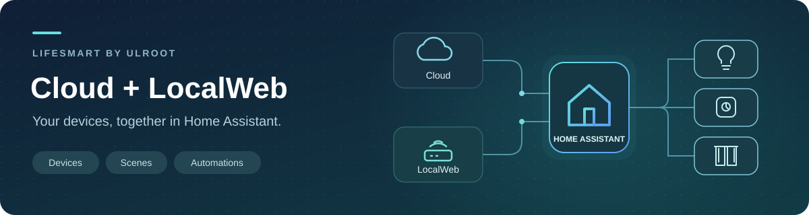

<p align="center">
  
</p>

<h1 align="center">LifeSmart for Home Assistant</h1>

<p align="center">
  <strong>LifeSmart 장치를 Home Assistant에서 편리하게 관리하세요.</strong><br>
  Cloud · LocalWeb · by ULROOT
</p>

<p align="center"><a href="../README.md">English</a> · <strong>한국어</strong></p>

<p align="center">
  <a href="../custom_components/lifesmart_ulroot/manifest.json"></a>
  <a href="https://www.home-assistant.io/"></a>
  <a href="#연결-설정"></a>
  <a href="../LICENSE"></a>
  <a href="README.ko.md"></a>
  <a href="https://app.fossa.com/projects/git%2Bgithub.com%2FULROOT-DEV%2Flifesmart-plugin-for-homeassistant-by-ulroot?ref=badge_shield&amp;issueType=license"></a>
</p>

<p align="center">
  
</p>

<p align="center"><a href="#설치">설치</a> · <a href="#연결-설정">연결 설정</a> · <a href="#지원-장치">지원 장치</a> · <a href="#scene과-리모컨">Scene·리모컨</a> · <a href="#문제-해결과-문의">문의</a></p>

---

## 어떤 기능을 사용할 수 있나요?

LifeSmart 조명·스위치·커튼·온도 조절기를 Home Assistant에서 제어하고, 센서 값을 확인하거나 장면을 실행하세요. 대시보드와 자동화에 함께 사용할 수 있습니다.

| ☁️ Cloud 연결 | 🏠 LocalWeb 연결 | 🧩 여러 스테이션 |
|---|---|---|
| LifeSmart 계정으로 연결합니다. 로그인하거나 기존 UserToken을 입력하세요. | 활성화된 스테이션에 집 안 네트워크로 직접 연결합니다. | Cloud는 모든 스테이션을 한 번에, LocalWeb은 스테이션별로 연결합니다. |
| **🎬 Scene·리모컨**<br>저장된 장면을 실행하고 지원되는 SPOT 리모컨의 키를 전송합니다. | **📊 장치·대시보드**<br>한 제품의 센서 값을 모아 보고 원하는 카드로 배치합니다. | **🌐 한국어·영어**<br>설정 화면과 엔티티 이름이 HA 언어 설정을 따릅니다. |

## 시작하기 전에

**Home Assistant 2026.11.1 이상**과 LifeSmart Smart Station이 필요합니다. 사용할 장치는 먼저 LifeSmart에 등록해 주세요.

| 연결 방식 | 준비할 정보 |
|---|---|
| **Cloud** | 인터넷 연결, App Key, App Token. 계정 로그인은 로그인 ID와 앱 비밀번호, UserToken 직접 입력은 숫자 **UserNo**와 유효한 UserToken이 필요합니다. 앱 인증 정보는 [LifeSmart Open Platform](https://www.ilifesmart.com/open/login)에서 준비하세요. |
| **LocalWeb** | 활성화된 스테이션의 IP 주소 또는 호스트명, LocalWeb 로그인 ID와 비밀번호. HA에서 스테이션에 접속할 수 있어야 합니다. |

> **LocalWeb은 스테이션 활성화가 필요합니다.** **LifeSmart 계정 userno와 앱 비밀번호(app pw)**를 **[ss.kim@ulroot.com](mailto:ss.kim@ulroot.com)**으로 보내 활성화를 요청하세요. 이 계정 정보는 스테이션의 LocalWeb 로그인 정보와 별개입니다. 활성화 정보는 담당자에게 이메일로만 전달하고 공개 이슈에는 올리지 마세요. 통합에서 직접 활성화할 수는 없습니다.

## 설치

### Marketplace에서 설치

[](https://my.home-assistant.io/redirect/marketplace_repository/?owner=ULROOT-DEV&repository=lifesmart-plugin-for-homeassistant-by-ulroot&category=integration)

1. Home Assistant에서 **설정 → Marketplace → 링크에서 추가(Add from link)**를 엽니다. 안내가 나오면 GitHub를 연결하세요.
2. 아래 저장소 URL을 입력합니다.

   ```text
   https://github.com/ULROOT-DEV/lifesmart-plugin-for-homeassistant-by-ulroot
   ```

3. **LifeSmart by ULROOT → 설치**를 선택합니다.
4. 이어서 열리는 설정 화면에서 **Cloud** 또는 **LocalWeb**을 선택하고 연결 정보를 입력합니다.

설치한 항목은 Marketplace에서 다시 열 수 있습니다. 설정 창을 닫았다면 **설정 → 기기 및 서비스 → 통합 구성요소 추가 → LifeSmart by ULROOT**에서 이어서 설정하세요. 재시작 안내가 나오면 그대로 진행하면 됩니다. [Marketplace 설치 안내](https://www.home-assistant.io/integrations/marketplace/#installing-a-repository)

<details>
<summary><strong>수동 설치</strong> — 통합 폴더를 직접 복사하기</summary>

1. 소스 또는 설치 ZIP을 내려받아 압축을 풉니다.
2. `custom_components/lifesmart_ulroot` 폴더 전체를 HA 설정 폴더 아래에 복사합니다.

   ```text
   <HA 설정 폴더>/
   └── custom_components/
       └── lifesmart_ulroot/
           ├── __init__.py
           ├── manifest.json
           ├── LICENSE
           └── …
   ```

3. Home Assistant를 재시작합니다.
4. **설정 → 기기 및 서비스 → 통합 구성요소 추가 → LifeSmart by ULROOT**를 선택합니다.

Docker/NAS에서는 컨테이너의 `/config`에 연결된 폴더를 사용하세요. `custom_components` 아래에는 저장소 전체가 아니라 `lifesmart_ulroot` 폴더를 넣어야 합니다.

</details>

## 연결 설정

### Cloud

**Cloud**를 선택하고 계정의 API 서버, **App Key**, **App Token**과 인증 정보를 입력하세요. 기본 서버는 **US**입니다. 현재 위치보다 계정이 등록된 서버를 기준으로 선택해야 합니다.

**계정을 한 번 등록하면 접근 가능한 모든 스테이션의 지원 장치를 불러옵니다.** 각 장치는 소속 스테이션 아래에 묶이며, 새로 추가한 스테이션도 보통 5분 이내에 자동으로 발견합니다. 계정과 App Key에 접근 권한이 있는 스테이션만 표시됩니다.

**UserToken 직접 입력**에서는 이메일 대신 숫자 **LifeSmart UserNo**를 입력하세요. 예: **`8123456`**. 계정 로그인 방식은 별도의 로그인 ID 항목에 LifeSmart 로그인 이메일을 입력하세요. 예: **`user@example.com`**. 숫자 UserNo로도 로그인할 수 있습니다.

| 인증 방법 | UserToken 처리 방식 |
|---|---|
| **계정 로그인** | LifeSmart 앱 비밀번호로 로그인합니다. UserToken을 자동 갱신하며, 비밀번호는 저장하지 않습니다. 기존 로그인 항목도 업데이트 후 자동 갱신을 사용합니다. |
| **UserToken 직접 입력 · 자동 갱신 끔** | 입력한 토큰을 그대로 사용합니다. 직접 입력의 기본값이며, 다른 앱에서 토큰을 관리할 때 적합합니다. |
| **UserToken 직접 입력 · 자동 갱신 켬** | 이 통합에서 토큰을 갱신하고 저장합니다. 같은 토큰을 사용하는 다른 앱에 영향을 줄 수 있습니다. |

**다른 앱에서 UserToken을 관리한다면 UserToken 직접 입력을 선택하고 자동 갱신을 꺼 두세요.** HA에서 재인증을 요청하면 최신 토큰을 입력하면 됩니다. 기존 장치와 엔티티는 유지됩니다.

<details>
<summary>자동 갱신은 언제 이루어지나요?</summary>

만료 시각을 모르면 처음 연결할 때 즉시 갱신해 만료 시각을 확인합니다. 이후에는 **만료 15분 전부터** API 요청 시 갱신합니다. 이미 만료되거나 거부된 토큰은 갱신할 수 없습니다. 만료 시점에 HA가 꺼져 있었다면 안내에 따라 다시 로그인하거나 유효한 토큰을 입력하세요.

통합의 재인증 알림이나 **설정 → 시스템 → 복구(Repairs)**에서 진행할 수 있습니다. UserToken 직접 입력은 재인증 후에도 자동 갱신 설정을 유지하고, 로그인 방식은 항상 자동 갱신을 사용합니다. 직접 입력의 자동 갱신 여부, 인증 방식, 계정 정보, 서버를 바꾸려면 **재구성(Reconfigure)**을 사용하세요.

</details>

<details>
<summary>선택할 수 있는 API 서버</summary>

| 선택 항목 | API 호스트 |
|---|---|
| **US** — 기본값 | `api.us.ilifesmart.com` |
| GLOBAL | `api.ilifesmart.com` |
| EUR | `api.eur.ilifesmart.com` |
| JP | `api.jp.ilifesmart.com` |
| APZ | `api.apz.ilifesmart.com` |
| CN0 | `api.cn0.ilifesmart.com` |
| CN1 | `api.cn1.ilifesmart.com` |
| CN2 | `api.cn2.ilifesmart.com` |

CN0는 주기적인 조회로 상태를 갱신합니다. 이전에 저장한 서버로 접속되지 않으면 **재구성**에서 계정에 맞는 서버를 다시 선택하세요.

</details>

### LocalWeb

1. 스테이션 활성화를 마친 뒤 **LocalWeb**을 선택합니다.
2. **스테이션 IP/호스트명**, **LocalWeb 로그인 ID**, **LocalWeb 비밀번호**를 입력합니다.
3. **HTTP (8008)** 또는 **HTTPS (8080)**을 선택합니다. 포트는 자동으로 적용됩니다.
4. HTTPS를 선택했다면 인증서 검증 여부를 정하고 설정을 마칩니다.

Home Assistant의 주소나 Cloud 계정이 아니라 **스테이션의 주소와 LocalWeb 로그인 정보**를 사용하세요. 공유기에서 스테이션 IP를 예약해 두면 주소가 바뀌어 접속이 끊기는 일을 줄일 수 있습니다.

<details>
<summary>HTTPS 인증서와 네트워크 설정</summary>

인증서 검증은 스테이션의 인증서를 신뢰할 수 있는지, 접속 주소와 일치하는지 확인하는 기능입니다. 가능하면 켜 두세요. 스테이션이 자체 서명 인증서를 사용하거나 주소가 인증서와 다르면 해당 스테이션의 검증을 끌 수 있습니다. 이때 HTTPS 암호화는 유지되지만 접속 대상의 신원은 검증하지 않습니다.

HTTP는 인증 정보를 암호화하지 않으므로 신뢰할 수 있는 내부 네트워크에서 사용하세요. HA 호스트나 컨테이너에서 선택한 HTTP/HTTPS 포트에 접근할 수 있어야 합니다. 실시간 알림은 HTTP 선택 시 TCP **8083**, HTTPS 선택 시 **8082**를 사용합니다. 알림 연결이 되지 않으면 주기적인 조회로 상태를 갱신합니다.

**실시간 알림 사용**을 켜면 TCP 연결 전에 스테이션의 알림 서비스를 자동으로 활성화합니다. 재연결할 때도 자동 실행하므로 별도로 API를 호출할 필요가 없습니다. 등록한 해당 스테이션의 LocalWeb 로그인 정보를 사용하며, 활성화나 TCP 연결이 실패하면 주기적인 조회를 계속합니다. 옵션을 끄면 이 통합의 TCP 연결을 종료하되, 다른 앱이 사용할 수 있도록 스테이션의 알림 서비스 자체는 끄지 않습니다.

LocalWeb은 기존 UDP/8888 연결 방식과 다릅니다. 스테이션별로 LocalWeb을 지원하고 활성화되어 있어야 합니다. 펌웨어가 스테이션 식별 정보를 반환하지 않으면 등록할 수 없습니다. 등록된 장치가 하나도 없다면 LifeSmart에 장치를 추가한 뒤 다시 시도하세요.

</details>

### 스테이션을 여러 대 연결하기

- **Cloud:** 같은 계정에 스테이션을 추가해도 HA에서 다시 등록할 필요가 없습니다. 다른 계정·앱 연결이 필요할 때만 항목을 추가하세요.
- **LocalWeb:** **설정 → 기기 및 서비스 → LifeSmart by ULROOT → 항목 추가 → LocalWeb**에서 스테이션별 IP, ID, 비밀번호를 입력하세요. 각 스테이션은 개별 활성화가 필요하며 독립적으로 동작합니다.
- **두 방식을 함께 사용:** LocalWeb으로 연결한 스테이션은 Cloud에서 제외됩니다. Cloud 장치를 LocalWeb으로 옮기려면 먼저 Cloud 항목의 **옵션 → 제외할 스테이션**에서 해당 스테이션을 제외한 뒤 LocalWeb 연결을 추가하세요. 별도 항목으로 추가되므로 전환 후 대시보드와 자동화의 참조를 확인하세요.

이전 버전에서 Cloud 스테이션을 각각 등록했다면, 업데이트 후 인증과 조회가 성공할 때 같은 API 서버·App Key·UserNo를 쓰는 항목을 자동으로 합칩니다. 기존 장치·엔티티 ID, 이름, 대시보드 참조는 유지합니다. 합칠 항목 중 UserToken 직접 입력의 자동 갱신이 꺼진 항목이 있다면, 그 직접 입력 방식과 갱신 끔 설정을 유지합니다. 업데이트 후 합쳐진 항목의 옵션을 확인하세요.

### 설정 변경하기

통합의 **옵션**에서 실시간 알림, 조회 주기, 제외할 장치를 설정할 수 있습니다. Cloud에서는 **제외할 스테이션**도 선택할 수 있습니다. 기본 조회 주기는 Cloud 60초, LocalWeb 30초이며 15~600초 사이에서 선택할 수 있습니다. 실시간 알림에 연결된 동안에도 5분마다 상태를 다시 확인합니다.

**재구성**에서 같은 UserNo의 Cloud 인증 정보·서버나 LocalWeb 스테이션의 주소·로그인 정보를 변경할 수 있습니다. Cloud 계정 항목 전체를 스테이션 한 대의 LocalWeb 연결로 바꿀 수는 없습니다. 같은 스테이션은 한 연결 방식으로만 관리합니다.

### 기기 이름

LifeSmart에 지정한 기기 이름이 있으면 그대로 표시합니다. 이름이 비어 있거나 장치 ID(`me`), 스테이션 ID(`agt`), 모델 코드와 같으면 **스마트 플러그**, **공기질 센서 Pro** 같은 제품명을 표시합니다. 이름 목록에 없는 모델은 **LifeSmart 장치**로 표시하며, 모델 코드는 기기 상세 정보에서 확인할 수 있습니다. Home Assistant에서 직접 지정한 이름이 가장 우선합니다.

기본 이름은 Home Assistant의 **시스템 언어**가 한국어이면 한국어로, 그 외에는 영어로 표시합니다. 기기 이름은 서버 전체에서 공유되므로 사용자 프로필 언어만 바꿔서 사용자별로 다르게 표시할 수는 없습니다. 시스템 언어를 변경했다면 통합을 다시 불러오면 모든 기본 이름에 반영됩니다. 기존 기기·엔티티 ID는 유지됩니다.

## 지원 장치

| 분류 | 사용할 수 있는 기능 |
|---|---|
| 💡 조명 | 켜기/끄기, 밝기, 지원 모델의 색온도·RGB/RGBW |
| 🔌 스위치·콘센트 | 채널별 제어, 지원 계량 장치의 전력·사용량 조회 |
| 🌡️ 센서 | 온도·습도·조도·공기질·동작·문 열림·경보 확인 |
| 🪟 커튼·차고문 | 열기/닫기/정지, 위치 정보를 제공하는 장치의 위치 제어 |
| ♨️ 냉난방·환기 | 온도 조절, 팬, 지원되는 공기청정기 기능 |
| 🔔 사이렌 | 장치에 설정된 소리로 켜기/끄기 |

사용 가능한 기능은 모델·펌웨어와 스테이션이 제공하는 정보에 따라 다릅니다. **카메라는 상태·센서 조회만 지원하며 영상은 제공하지 않습니다. 도어록은 지원되는 배터리·경보·초인종 정보만 조회하며 원격 해제는 지원하지 않습니다.** 일부 모델은 연결 상태만 표시됩니다. 장치별 범위는 [상세 지원 기능](SUPPORTED_DEVICES.md)에서 확인하세요.

<details>
<summary><strong>지원 모델 식별자와 장치 이름 전체 보기</strong></summary>

장치 정보의 `devtype`으로 찾아보세요. 구분이 필요한 버전 식별자도 함께 표시했습니다.

| `devtype` / 버전 | 장치 이름 | 기능 / 범위 |
|---|---|---|
| `ELIQ_EM` | ELIQ 전력계 | `sensor` |
| `LSCAM:LSCAMV1` | 카메라 상태 | `binary_sensor`, `sensor` (상태 조회) |
| `LSCAM:LSICAMEZ1` | 카메라 상태 | `binary_sensor`, `sensor` (상태 조회) |
| `LSCAM:LSICAMEZ2` | 카메라 상태 | `binary_sensor`, `sensor` (상태 조회) |
| `LSCAM:LSICAMGOS1` | 카메라 상태 | `binary_sensor`, `sensor` (상태 조회) |
| `LSCAM:LSI_CAM_EZ1` | 카메라 상태 | `binary_sensor`, `sensor` (상태 조회) |
| `LSCAM:LSI_CAM_GOS1` | 카메라 상태 | `binary_sensor`, `sensor` (상태 조회) |
| `LSCAM:LSLKCAMV1` | 카메라 상태 | `binary_sensor`, `sensor` (상태 조회) |
| `LSCAM:SL_CAM` | 카메라 상태 | `binary_sensor`, `sensor` (상태 조회) |
| `LSSSMINIV1` | 다기능 알람 | 연결 상태만 |
| `MSL_IRCTL` | SPOT 적외선 제어기 | `light`, `remote` |
| `OD_JIUWANLI_LOCK1` | JiuWanLi 도어록 | 연결 상태만 |
| `OD_MFRESH_M8088` | 공기청정기 | `fan`, `sensor` |
| `OD_WE_IRCTL` | SPOT 적외선 제어기 | `light`, `remote` |
| `OD_WE_OT1` | 콘센트 | `switch` |
| `OD_WE_QUAN` | 컬러·조경 조명 | `light` |
| `SL_ALM` | 스마트 알람 | `siren` |
| `SL_BP_MZ` | 동작감지센서Pro | `binary_sensor` |
| `SL_CN_FE` | 커튼 제어기 | `cover` |
| `SL_CN_IF` | 커튼 제어기 | `cover` |
| `SL_CP_AIR` | 온도조절기 | `climate` |
| `SL_CP_DN` | 온도조절기 | `climate`, `sensor` |
| `SL_CP_VL` | 온도조절기 | `binary_sensor`, `climate`, `sensor` |
| `SL_CT_RGBW` | 컬러·조경 조명 | `light` |
| `SL_DF_BB` | DEFED 리모컨 | `binary_sensor`, `sensor` |
| `SL_DF_GG` | DEFED 문열림 센서 | `binary_sensor`, `sensor` |
| `SL_DF_MM` | DEFED 동작 센서 | `binary_sensor`, `sensor` |
| `SL_DF_SR` | DEFED 사이렌 | `binary_sensor`, `sensor`, `siren` |
| `SL_DOOYA` | DOOYA 모터 | `cover` |
| `SL_DOOYA_V1` | DOOYA 모터 | `cover` |
| `SL_DOOYA_V2` | DOOYA 모터 | `cover` |
| `SL_DOOYA_V3` | DOOYA 모터 | `cover` |
| `SL_DOOYA_V4` | DOOYA 모터 | `cover` |
| `SL_ETDOOR` | 차고문 | `cover`, `switch` |
| `SL_JEMA` | 범용·HA 제어기 | `binary_sensor`, `cover`, `switch` |
| `SL_LI_GD1` | 컬러·조경 조명 | `binary_sensor`, `light`, `sensor` |
| `SL_LI_RGBW` | 컬러·조경 조명 | `light` |
| `SL_LI_UG1` | 컬러·조경 조명 | `binary_sensor`, `light`, `sensor` |
| `SL_LI_WW` | 색온도 조명 | `light` |
| `SL_LK_AG` | 도어록 | `binary_sensor`, `sensor` (상태 조회) |
| `SL_LK_DJ` | 도어록 | `binary_sensor`, `sensor` (상태 조회) |
| `SL_LK_GTM` | 도어록 | `binary_sensor`, `sensor` (상태 조회) |
| `SL_LK_LS` | 도어록 | `binary_sensor`, `sensor` (상태 조회) |
| `SL_LK_SG` | 도어록 | `binary_sensor`, `sensor` (상태 조회) |
| `SL_LK_TY` | 도어록 | `binary_sensor`, `sensor` (상태 조회) |
| `SL_LK_YL` | 도어록 | `binary_sensor`, `sensor` (상태 조회) |
| `SL_MC_ND1` | Stellar 보조 스위치 1 | `switch` |
| `SL_MC_ND2` | Stellar 보조 스위치 2 | `switch` |
| `SL_MC_ND3` | Stellar 보조 스위치 3 | `switch` |
| `SL_NATURE` | Nature 패널 | `climate`, `switch` (보드에 따라 구분) |
| `SL_NATURE_X` | Nature 패널 | `switch` |
| `SL_OE_3C` | 콘센트 | `sensor`, `switch` |
| `SL_OE_DE` | 콘센트 | `sensor`, `switch` |
| `SL_OL` | 스마트 콘센트 | `switch` |
| `SL_OL_3C` | 스마트 콘센트 | `switch` |
| `SL_OL_DE` | 스마트 콘센트 | `switch` |
| `SL_OL_UK` | 스마트 콘센트 | `switch` |
| `SL_OL_UL` | 스마트 콘센트 | `switch` |
| `SL_OL_W` | 콘센트 | `switch` |
| `SL_P` | 범용·HA 제어기 | `binary_sensor`, `cover`, `switch` |
| `SL_P_A` | 연기 센서 | `binary_sensor`, `sensor` |
| `SL_P_BDLK` | BE-TECH 도어록 모듈 | 연결 상태만 |
| `SL_P_IR` | SPOT 적외선 제어기 | `binary_sensor`, `remote` |
| `SL_P_IR_V2` | SPOT 적외선 제어기 | `binary_sensor`, `remote` |
| `SL_P_RM` | 동작 센서 | `binary_sensor` |
| `SL_P_SW` | 스위치·제어기 | `switch` |
| `SL_P_V2` | 커튼 제어기 | `cover` |
| `SL_S` | 스위치·제어기 | `switch` |
| `SL_SC_BB` | CUBE 버튼 | `binary_sensor`, `sensor` |
| `SL_SC_BB_V2` | CUBE 버튼 | `binary_sensor`, `sensor` |
| `SL_SC_BE` | 환경 센서 | `binary_sensor`, `sensor` |
| `SL_SC_BG` | 문열림 센서 | `binary_sensor`, `sensor` |
| `SL_SC_BM` | 동작 센서 | `binary_sensor`, `sensor` |
| `SL_SC_CA` | CO2·공기질 센서 | `sensor` |
| `SL_SC_CH` | 포름알데히드 센서 | `binary_sensor`, `sensor`, `siren` |
| `SL_SC_CM` | 동작 센서 | `binary_sensor` |
| `SL_SC_CN` | 소음 센서 | `binary_sensor`, `sensor`, `siren` |
| `SL_SC_CP` | 가스 센서 | `binary_sensor`, `sensor`, `siren` |
| `SL_SC_CQ` | CO2·공기질 센서 | `sensor` |
| `SL_SC_CV` | 큐로봇 | 연결 상태만 |
| `SL_SC_G` | 문열림 센서 | `binary_sensor`, `sensor` |
| `SL_SC_MHW` | 동작 센서 | `binary_sensor`, `sensor` |
| `SL_SC_RGB` | 컬러·조경 조명 | `light` |
| `SL_SC_THL` | 환경 센서 | `sensor` |
| `SL_SC_WA` | 누수 센서 | `binary_sensor`, `sensor` |
| `SL_SF_IF1` | BLEND 스위치 1 | `switch` |
| `SL_SF_IF2` | BLEND 스위치 2 | `switch` |
| `SL_SF_IF3` | BLEND 스위치 3 | `switch` |
| `SL_SF_RC` | 스위치·제어기 | `switch` |
| `SL_SPOT` | SPOT 적외선 제어기 | `light`, `remote` |
| `SL_SPWM` | 조광기 | `light` |
| `SL_SW_BJ84` | Air스위치 | `switch` |
| `SL_SW_BS1` | Polar 스위치 1 | `switch` |
| `SL_SW_BS2` | Polar 스위치 2 | `switch` |
| `SL_SW_BS3` | Polar 스위치 3 | `switch` |
| `SL_SW_CP1` | BLEND 스위치 1 | `switch` |
| `SL_SW_CP2` | BLEND 스위치 2 | `switch` |
| `SL_SW_CP3` | BLEND 스위치 3 | `switch` |
| `SL_SW_DM1` | 조광기 | `binary_sensor`, `light`, `sensor` |
| `SL_SW_DM1_V1` | 조광기 | `binary_sensor`, `light`, `sensor` |
| `SL_SW_DM1_V2` | 조광기 | `binary_sensor`, `light`, `sensor` |
| `SL_SW_FE1` | Senna·Gezhi 스위치 1 | `switch` |
| `SL_SW_FE2` | Senna·Gezhi 스위치 2 | `switch` |
| `SL_SW_IF1` | BLEND 스위치 1 | `switch` |
| `SL_SW_IF2` | BLEND 스위치 2 | `switch` |
| `SL_SW_IF3` | BLEND 스위치 3 | `switch` |
| `SL_SW_MJ1` | CUBE 스위치 모듈 1 | `switch` |
| `SL_SW_MJ2` | CUBE 스위치 모듈 2 | `switch` |
| `SL_SW_MJ3` | CUBE 스위치 모듈 3 | `switch` |
| `SL_SW_ND1` | Stellar·Polar 스위치 1 | `switch` |
| `SL_SW_ND2` | Stellar·Polar 스위치 2 | `switch` |
| `SL_SW_ND3` | Stellar·Polar 스위치 3 | `switch` |
| `SL_SW_NS1` | Nature 스위치 1 | `switch` |
| `SL_SW_NS2` | Nature 스위치 2 | `switch` |
| `SL_SW_NS3` | Nature 스위치 3 | `switch` |
| `SL_SW_NS6` | 스위치·제어기 | `switch` |
| `SL_SW_RC` | 스위치·제어기 | `switch` |
| `SL_SW_RC1` | 120 스위치 1 | `switch` |
| `SL_SW_RC2` | 120 스위치 2 | `switch` |
| `SL_SW_RC3` | 120 스위치 3 | `switch` |
| `SL_SW_WIN` | 커튼 제어기 | `cover` |
| `SL_SW_WW` | 색온도 조명 | `light` |
| `SL_TR_ACIPM` | 환기 제어기 | `fan`, `sensor` |
| `SL_UACCB` | 냉난방 제어기 | `climate` |
| `V_485_P` | 전력계·485 제어기 | `sensor`, `switch` |
| `V_AIR_P` | 냉난방 제어기 | `climate` |
| `V_DLT645_P` | 전력계·485 제어기 | `sensor` |
| `V_DLT_645_P` | 전력계·485 제어기 | `sensor` |
| `V_FRESH_P` | 환기 제어기 | `fan`, `sensor` |
| `V_HG_WW` | 조명제어디머 | `light` |
| `V_HTTP_P` | AWAIR공기질계측기 | `sensor` |
| `V_IND_S` | 가상스위치 | `switch` |
| `V_SI` | 가상스위치 | `switch` |
| `V_SZJSXR_P` | 냉난방 제어기 | `climate` |
| `V_T8600_P` | 냉난방 제어기 | `climate` |
| `ZG#INAHO.Door_Lock` | ZigBee 도어록 | `sensor` (상태 조회) |
| `ZG#JT-GA102` | ZigBee 센서 | `binary_sensor` |
| `ZG#MIR-HE200` | ZigBee 센서 | `binary_sensor`, `sensor` |
| `ZG#MIR-SM100-E` | ZigBee 센서 | `binary_sensor`, `sensor` |
| `ZG#PMT300-S-ZTN` | ZigBee 센서 | `sensor` |
| `ZG#PMT300-SGMR-ZTN` | 공기질센서Pro | `sensor` |
| `ZG#RH8005` | ZigBee 도어록 | `sensor` (상태 조회) |
| `ZG#TS0121` | ZigBee 전력 콘센트 | `sensor`, `switch` |
| `ZG#TS06012` | 재실센서 | `binary_sensor` |
| `ZG#YMC420D` | ZigBee 도어록 | `sensor` (상태 조회) |
| `ZG#ZBT-OnOffPlug-D0#` | ZigBee 전력 콘센트 | `sensor`, `switch` |
| `ZG#c700000202` | ZigBee 도어록 | `sensor` (상태 조회) |
| `cam` | 카메라 상태 | `binary_sensor`, `sensor` (상태 조회) |

</details>

## 대시보드와 자동화

제품 하나는 **하나의 기기**로 묶이고, 온도·습도처럼 각각의 기능은 엔티티로 표시됩니다. 환경 센서에 엔티티가 여러 개 있어도 카드까지 따로 만들 필요는 없습니다.

**엔티티 카드** 하나에 온도·습도·조도를 함께 넣거나, 원하는 값을 자동화 조건으로 사용하세요. [대시보드 예시](DASHBOARD.md)를 참고하면 됩니다. 카드 배치는 사용자가 원하는 방식으로 구성할 수 있습니다.

## Scene과 리모컨

**Scene:** LifeSmart에서 장면을 만들어 두면 HA에 `scene` 엔티티로 표시됩니다. 대시보드에 추가하거나 자동화의 **장면 활성화** 액션(`scene.turn_on`)으로 실행하세요. Cloud와 LocalWeb 모두 사용할 수 있으며, 장면의 내용은 LifeSmart에서 생성·수정합니다.

**SPOT 리모컨:** 지원되는 에어컨 이외의 저장된 리모컨은 SPOT 장치 아래 `remote` 엔티티로 표시됩니다. **명령 전송** 액션(`remote.send_command`)에 해당 리모컨의 키 이름(예: `POWER`)을 입력하세요. 엔티티의 켜짐 표시는 송신 준비 상태이며 가전의 실제 전원 상태가 아닙니다. IR 학습, 에어컨 상태 명령, 반복·길게 누르기는 지원하지 않습니다.

새 장면이나 리모컨은 약 5분 이내에 목록에 반영됩니다. 바로 확인하려면 통합을 다시 불러오세요. 그룹과 예약은 Scene으로 가져오지 않습니다.

## 문제 해결과 문의

| 증상 | 확인할 내용 |
|---|---|
| 저장소를 추가할 수 없음 | URL, GitHub 연결, 저장소 접근 가능 여부, HA 버전을 확인하세요. |
| Cloud 인증 실패 | API 서버, App Key/App Token 조합, User ID, 토큰 유효성을 확인하세요. |
| UserToken 만료 또는 변경 | 재인증 알림이나 **설정 → 시스템 → 복구**에서 유효한 토큰을 입력하세요. |
| LocalWeb 연결 실패 | 활성화 여부, 스테이션 주소·계정, HTTP/HTTPS 선택, HA 호스트·컨테이너에서의 통신을 확인하세요. |
| 장치나 기능이 표시되지 않음 | 위 목록에서 `devtype`을 찾고 스테이션에 해당 기능이 표시되는지 확인하세요. 필요하면 모델·펌웨어 정보와 함께 문의하세요. |
| 장치가 중복 표시됨 | 다른 LifeSmart 통합이 같은 스테이션에 연결되어 있는지 확인하세요. |
| 새 Scene이 보이지 않음 | LifeSmart에서 먼저 장면을 만든 뒤 다음 조회를 기다리거나 통합을 다시 불러오세요. |
| 명령 결과를 확인할 수 없음 | 다시 실행하기 전에 장치의 실제 상태를 확인하세요. 응답이 늦어도 명령은 이미 도착했을 수 있습니다. |

**사용 중 오류나 문제는 [ss.kim@ulroot.com](mailto:ss.kim@ulroot.com)으로 문의하세요.** HA·통합 버전, Cloud/LocalWeb 중 사용한 방식, 장치 모델(`devtype`), 알고 있다면 펌웨어 버전, 민감 정보를 지운 오류 내용을 보내주시면 도움이 됩니다. 일반 오류 문의에는 토큰·비밀번호를 넣지 마세요. LocalWeb 활성화 요청은 **시작하기 전에**의 별도 안내를 따릅니다.

재현 가능한 오류는 [GitHub Issues](https://github.com/ULROOT-DEV/lifesmart-plugin-for-homeassistant-by-ulroot/issues)에도 등록할 수 있습니다. 공개 글에는 계정 정보, 토큰, 스테이션 식별 정보를 포함하지 마세요.

### 업데이트·삭제

업데이트 전 HA를 백업하세요. Marketplace에서 업데이트하거나, 수동 설치라면 통합 폴더를 새 파일로 교체한 뒤 안내에 따라 재시작합니다.

삭제할 때는 먼저 통합의 항목을 제거하고 Marketplace에서 저장소를 삭제하세요. 수동 설치는 `custom_components/lifesmart_ulroot` 폴더를 제거한 뒤 재시작합니다. 삭제된 엔티티를 참조하는 카드나 자동화는 수정이 필요할 수 있습니다.

### 인증 정보와 연결

연결 정보는 HA 설정 저장소에 보관되므로 설정 폴더와 백업 파일을 안전하게 관리하세요. Cloud는 LifeSmart 서버와 통신합니다. LocalWeb은 활성화된 스테이션에 직접 연결하며 일반적인 사용에 ULROOT 중계 서버가 필요하지 않습니다. 업데이트를 내려받으려면 인터넷 연결이 필요합니다.

## 라이선스

이 프로젝트에는 **[ULROOT Source-Available License 1.0](../LICENSE)**이 적용됩니다.

- **허용:** 개인·조직 내부 사용, 수정, 동일 라이선스와 고지를 유지하는 무료 재배포.
- **사전 서면 허가 필요:** 원본·수정본 판매, 유료 소프트웨어 이용·구독·호스팅 서비스, 판매용 제품·장비 묶음에 포함한 납품.
- **작업비:** 설치·설정·교육·유지보수 비용은 LICENSE 5항 조건을 충족할 때 허용됩니다. 고객이 소프트웨어 자체를 별도로 무료 입수·사용할 수 있어야 합니다.

상업적 이용 허가는 **[ss.kim@ulroot.com](mailto:ss.kim@ulroot.com)**으로 문의하세요. LocalWeb 활성화는 판매 허가와 별개입니다. 라이선스 전문은 설치 폴더에도 포함되어 있습니다. [한국어 상세 안내](LICENSE.ko.md)와 [이미지·제3자 권리 고지](ASSETS.md)를 함께 확인하세요.

[](https://app.fossa.com/projects/git%2Bgithub.com%2FULROOT-DEV%2Flifesmart-plugin-for-homeassistant-by-ulroot?ref=badge_large&issueType=license)

---

[기여 안내](../CONTRIBUTING.md) · [개발 문서](DEVELOPMENT.md)
