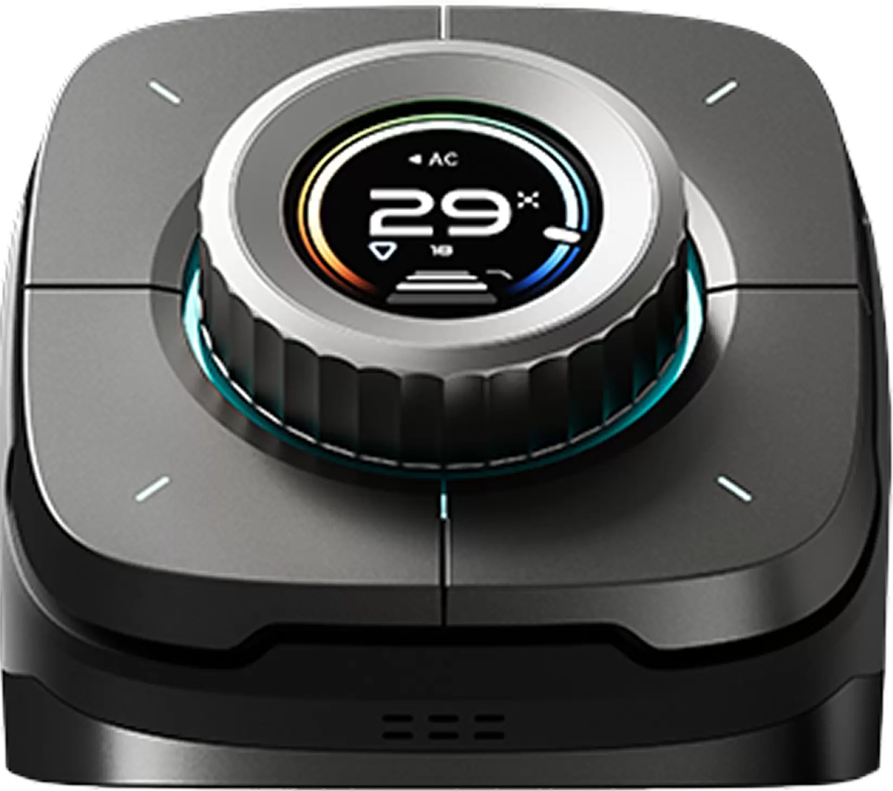
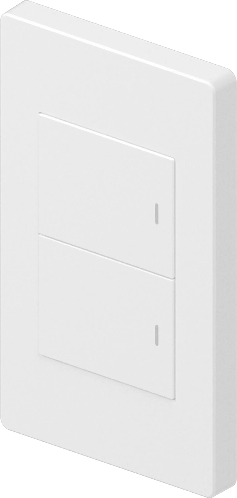
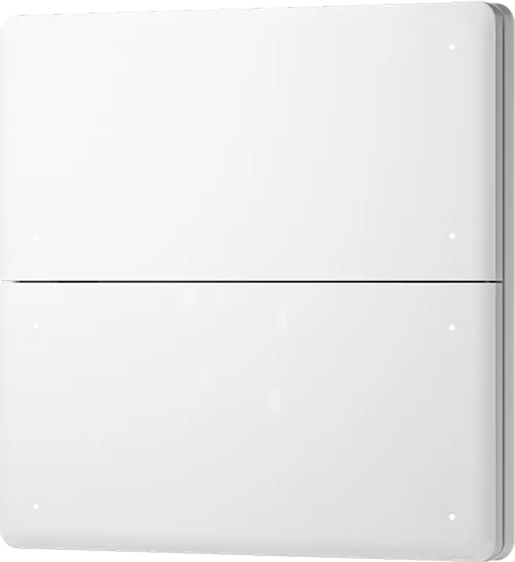

# Supported models and capabilities

The full devtype/name tables are in the [English README](../README.md#supported-devices) and [한국어 README](README.ko.md#지원-장치). Both transports use the same mappings; capabilities require the documented channels to be present. This documents implemented behavior, not physical certification of every model/firmware.

## Implemented scope / 구현 범위

| Family | Entities and channel behavior |
|---|---|
| Sockets, in-wall/BLEND/Polar/Nature switches | Model-specific `O`, `P`, `L` switch channels. Metering sockets add IEEE754 `P2` energy and `P3` power. |
| General `SL_P`, HA `SL_JEMA` | Interpret `P1` operating-mode bits. Relay modes expose `P2..P4`; curtain modes expose open/stop/close, never three independent motor relays. HA auxiliary outputs `P8..P10` remain independent. |
| Dimmers / white lights | Brightness and power; `P2` color temperature where documented. Associated motion/illuminance sensors when present. |
| RGB/RGBW / landscape / Cololight | Packed RGB(W), power and brightness, per-model white/brightness ranges. Disable `DYN` with the static color command using `EpsSet`. No dynamic effect editor. |
| DOOYA and garage motors | Position, movement direction, open/close/stop and target position. `SL_ETDOOR` also has its documented light switch. |
| Pulse curtain controllers | Open/stop/close only. No invented position when the controller supplies none. |
| Environment, gas, smoke, water, radar, DEFED, ZigBee | Documented temperature, humidity, illuminance, particles, gases, noise, motion, contact, alarm, tamper and battery channels. Button reports are binary/event-code sensors, not HA device triggers. |
| DLT / 485 / ZigBee metering | Energy/power IEEE754 and typed fixed-point values; voltage/current/frequency/power factor and supported environmental channels. Only documented switch channels become writable. |
| `V_AIR_P`, third-party aliases, `SL_UACCB` | Power, HVAC mode, target/current temperature and fan speed where present. |
| `SL_CP_DN`, `SL_CP_VL`, `SL_CP_AIR` | Floor/radiator/fan-coil thermostat controls; packed mode/fan changes preserve other configuration bits. Scheduling, calibration, installer parameters and valve overrides are not exposed. |
| `SL_NATURE` thermostat | Distinguish thermostat from relay panel using board/configuration channels. Respect CFG-supported HVAC/fan modes. DN and DN+Heat read as heat; advanced combined-heating mode selection remains in LifeSmart. |
| Ventilation / purifier | Power and documented speed; `V_FRESH_P` has separate supply/exhaust fan entities. `SL_TR_ACIPM` speed changes require manual mode already selected in LifeSmart. Purifier operating mode is read-only. |
| Sirens | DEFED, smart alarm and documented sensor buzzer channels: on/off using existing device sound configuration. Tone/volume/duration editing is not exposed. |
| Door locks | Battery, alarm and doorbell telemetry when available. No lock/unlock entity or inferred door-lock state; authorization and vendor-specific unlock procedures are outside this implementation. |
| Cameras | Motion, battery/status telemetry where available. No video stream or snapshot endpoint is specified by the supplied device table. |
| SPOT | Documented light functionality and saved non-AC remote key sending. AC remotes, IR learning and code-library management are not exposed. |
| `SL_SC_CV`, `LSSSMINIV1`, `OD_JIUWANLI_LOCK1`, `SL_P_BDLK` | Connectivity only: listed in the appendix without a complete functional-channel contract. 연결 상태만 지원하며 제어 지원으로 표시하지 않습니다. |

Signed fixed-point, IEEE754, zero/negative values and invalid sentinels are decoded according to the channel type. A supplied display value is used once without double scaling. Battery voltage is not converted into a guessed percentage. Additional supported model mappings are included in the README tables. Unknown models create no speculative controls; recognized models lacking usable channels expose connectivity.

## Scene and remote protocols

- Cloud: `SceneGet` discovery and `SceneSet` activation; station identity is included in both. SPOT `irapi.GetRemoteList` and `irapi.SendRemotesKeys`; the latter excludes `keys` from signing as required by the SPOT manual.
- LocalWeb: `GetAllAIs` discovery, `ControlAI` with serialized `{"command":"runOnce"}` and `nonResp=1`; SPOT `GetRemoteList` / `SendKeys`.
- Import only `cls=scene`, filter foreign stations, preserve stable station-scoped identities, rediscover about every five minutes. The scene entity belongs to its station; a remote belongs to its SPOT.
- Commands are not replayed after timeout. Acknowledgement is not proof that every scene action or IR target completed. Scene/group editing is not supported.

## Manual references

The supplied manuals were consulted locally and are not redistributed in this repository:

- *LifeSmart Device Attribute List v2.29 (2023-11-13)*: device tables pp.6–85, complete model appendix pp.85–90, numeric representation pp.93–99, third-party controller aliases pp.100–101.
- *LifeSmart Cloud Platform ZigBee API v2.4*: device appendix pp.72–75.
- *LifeSmart Cloud Platform API v1.38 (2023-12-12)*: SceneGet pp.69–72, SceneSet pp.73–75.
- *LifeSmart Smart Station Local Web Service Interface*: device read/write and `EpsSet` contracts.
- *Local Web AIAPI*: GetAllAIs pp.17–18, ControlAI pp.24–25.
- *LifeSmart Spot Cloud Platform API v2*: GetRemoteList and SendRemotesKeys pp.27–29; *Local Web SPOT*: SendKeys pp.6–7.

## Validation and support

See [validation evidence](VALIDATION.md) for simulated and live checks. Device controls, scene execution and IR transmission have not been exercised on physical equipment in this change. For problems or additional documented device features, contact **[ss.kim@ulroot.com](mailto:ss.kim@ulroot.com)** with model, firmware, integration/HA versions and sanitized error details.

## Product artwork

These identify product families, not certified compatibility. [Artwork sources and terms](ASSETS.md).
